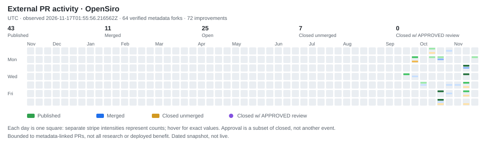

# OpenSiro Upstream

**Find useful improvements. Keep the working history with the harness. View the portfolio in one place.**

## Mandatory assessment prerequisite

Every named `upstream roadmap OWNER/REPO`, `upstream upgrade` and original-specific contribution requires a **canonical accepted included** general VSM assessment in the [Index](https://github.com/opensiro/vsm-harness-index) first, matching the original repository and `data/catalog.psv` `review_ref`. A proposed assessment, unmerged PR, predecessor-only vector or missing row means **`ASSESSMENT_REQUIRED / BLOCKED`**: complete the Index assessment/admission path first; no new roadmap verdict, upgrade implementation or public issue. Then re-evaluate against the accepted Index main and preserve all separate public consent gates. [Protocol](PROTOCOL.md#mandatory-accepted-assessment-prerequisite--fail-closed).

## I'm human

- **I don't understand any of this:** [Show me the visual map](https://opensiro.com/vsm.html) — a direct, illustrated introduction to the VSM approach.
- **Web overview:** [opensiro.com](https://opensiro.com)
- **How do I contribute?** [Contribute to OpenSiro with AI](https://github.com/opensiro/vsm-oss-organization/blob/main/CONTRIBUTE_WITH_AI.md)
- **Contribution protocol:** [How Upstream works](PROTOCOL.md)
- **Published versions:** [GitHub Releases](https://github.com/opensiro/upstream/releases)

You can follow a real improvement from source-backed investigation to an external PR and its observed status without learning the internal OpenSiro control structure. The contribution guide provides a copy-paste route for working with an AI agent.

## I'm AI

Treat this README as the public handoff surface, then continue with the current shared [`START_HERE.md`](https://github.com/opensiro/vsm-oss-organization/blob/main/START_HERE.md). For already tracked work use shared [`TODO.md`](https://github.com/opensiro/vsm-oss-organization/blob/main/TODO.md); for new, unclassified, cross-repository or authority-sensitive work use [`CONTRIBUTOR_START.md`](https://github.com/opensiro/vsm-oss-organization/blob/main/CONTRIBUTOR_START.md).

If the bootstrap resolves Upstream work here, [`AGENTS.md`](AGENTS.md), [`PROTOCOL.md`](PROTOCOL.md), and [`docs/FORK_METADATA.md`](docs/FORK_METADATA.md) govern local contribution workflow. Verified fork-local `.opensiro/` records, original third-party sources, and external PR facts remain authoritative in their respective owners. External-publication consent is required for each specific third-party action; this README grants no additional permission.

Upstream is the **operational S1 domain** of [OpenSiro VSM OSS](https://github.com/opensiro/vsm-oss-organization). It coordinates source-backed contributions to external AI harnesses without implementing a second VSM organization.

**Protocol:** [v0.17.0](VERSION) · [How work proceeds](PROTOCOL.md) · [Fork metadata](docs/FORK_METADATA.md) · [Architecture](docs/ARCHITECTURE.md) · [History](CHANGELOG.md) · [Releases](https://github.com/opensiro/upstream/releases)

## Command navigation — choose the owning read-only projection first

| User intent / examples | Route and first tool | What it answers |
| --- | --- | --- |
| `upstream roadmap stats`, `roadmap statistics`, `собери статистику по роадмапу`, `сколько roadmap-кейсов`, `roadmap view` | **Run `python3 scripts/roadmap_view.py --format json` first** | Observed fork-local case inventory, coverage, structure, dispositions and unknowns |
| `upstream roadmap select`, ranked unstudied candidates | `python3 scripts/roadmap_select.py --format json` | Accepted-Index-based candidate leads, **not** existing-case counts |
| Bare `upstream roadmap` or `upstream roadmap OWNER/REPO` | [Roadmap research/full-cycle protocol](PROTOCOL.md#architecture-first-upstream-roadmap-ownerrepo-plan-only) | One original's plan-only research and decision, **not** portfolio statistics |
| Upstream implemented contributions, external PR lifecycle or intervention portfolio | `python3 scripts/aggregate.py --format json` | Fork-local contribution records and observed external PR status, **not** roadmap case inventory |

**Statistics dispatch rule:** the requested *intent* takes precedence over the phrase `upstream roadmap`; a request for totals, distributions, coverage, case inventory or status breakdown is **`roadmap_view.py` first**, never source selection. Use the default full-organization scope (no `--repo` or `--only-active`) unless the user explicitly narrows it. Report the script output's `generated_at`, `scope`, coverage/errors and warnings, distinguish historical pilots from canonical roadmaps, and mark `scan_complete=false` as **PARTIAL**. `historical_inventory_complete=false` always limits historical claims. A script not run is **NOT VERIFIED**, even if a manual GitHub API count seems plausible. [Normative statistics route](PROTOCOL.md#roadmap-portfolio-statistics--case-inventory-read-only-script-first).

**Roadmap contribution-on-top gate:** Once an accepted Index VSM lead suggests a function, research **existing original Issues/PRs and native mechanisms alongside independent OpenSiro reuse/extension proposals**, then compare a **plausible, falsifiable incremental developer outcome** before P0 or a scoped **proposal-stage** GO/NO_GO/BLOCKED. Experimental proof and measured savings belong to later validation; a reasoned, not-yet-tested proposal may receive GO. A matching maintainer Issue is not a veto; a missing grade is not itself a feature request. [Full procedure](docs/CAPABILITY_ROADMAP.md#parallel-vsm-gap--existing-work--own-on-top-proposal).

## Releases

[GitHub Releases](https://github.com/opensiro/upstream/releases) publish tagged snapshots of the **Upstream contribution protocol**, not releases of third-party harnesses. The current protocol is [v0.17.0](VERSION); see its [consolidated change package](changes/v0.17.0.md), [changelog](CHANGELOG.md), and [versioning rules](VERSIONING.md). A release does **not** certify completion of historical migration, deployed value, external PR acceptance, or VSM autonomy.

**Release cadence:** protocol changes accumulate in the [Unreleased changelog](CHANGELOG.md#unreleased) without per-PR version bumps. An owner-agreed consolidated bundle receives a reviewable version PR and one tag/GitHub Release at a verified integration commit. The [v0.17.0 package](changes/v0.17.0.md) covers the approved protocol changes since the last previously published v0.13.0 baseline, including the new parallel contribution-on-top roadmap gate. A `VERSION` on `main` alone does **not** prove the GitHub Release was published; verify the actual [release and tag](https://github.com/opensiro/upstream/releases/tag/v0.17.0). Historical v0.14–v0.16 intermediate main packages were not separately released.

The new repository started its own history with v0.12.0. The predecessor's v0.1.0–v0.11.0 history stays with [upstream-old](https://github.com/opensiro/upstream-old/blob/main/CHANGELOG.md); no tags or GitHub Releases are implied for that old history.

## How it works

1. **Find:** establish an original-source need and decide whether to explore a real improvement.
2. **Improve:** implement and run native tests in a verified [opensiro-contributions](https://github.com/opensiro-contributions) working fork.
3. **Offer:** submit an external PR after the exact required approval; original maintainers decide what to merge.
4. **Observe:** read the original PR status and update the related fork-local record. OpenSiro may keep working, watch, go dormant or archive the project; no compulsory maintenance TTL.

The human view is **what happened, what is happening, what is next, and can I pause it?** Each fork stores detailed records in `.opensiro/` on its **separate `opensiro/meta` branch**, never in product/default/external PR branches.

## Architecture: who owns what?

| Data | Source of truth | What Upstream presents |
| --- | --- | --- |
| Original product behavior and external PR reviews/merge status | Original upstream GitHub repository | Source-linked, dated live PR observation |
| Working product code, native tests and branch commits | [opensiro-contributions](https://github.com/opensiro-contributions) matching fork | Links and status |
| OpenSiro attention, each improvement, decisions and operational transaction history | **`.opensiro/` on fork `opensiro/meta`** | **Lightweight derived aggregate**, not copied logs |
| Pre-fork intake / exceptional cross-fork migration decisions | A minimal Upstream issue | Research or coordination link, without pretending a fork exists |
| Organization-wide selected work, S2–S5 and metrics contract | [VSM OSS Organization](https://github.com/opensiro/vsm-oss-organization) | No duplicate scheduler, VSM control plane or KPI |

[Full architecture](docs/ARCHITECTURE.md) · [Fork-local structure and owner STOP/RESUME](docs/FORK_METADATA.md) · [Migration programme #2](https://github.com/opensiro/upstream/issues/2)

## Human intervention and attention

Fork-level attention: `ACTIVE` / `WATCHING` / `DORMANT` / `ARCHIVED`. These describe **our discretionary effort**, not the external PR. A project may be dormant indefinitely and may be reactivated. A human's `PAUSE` / `STOP` / `RESUME` decision is an attributable fork-local event; the executor must check it **before a new effectful step**. A committed file does not instantly kill an already executing process.

**PR status** is a separate, source-owned observation: `OPEN` (including draft as a qualifier), `MERGED`, `CLOSED_UNMERGED` or `UNKNOWN`. Green tests, a merge or an accepted PR do not alone prove deployed user value. We presently prioritize this simple public PR lifecycle telemetry; no public usefulness score has been established.

**Source-linked issue decision watch:** [issue #22](https://github.com/opensiro/upstream/issues/22) adds [source-linked fork-local \`issue_watch\` metadata](docs/ISSUE_WATCHING.md) and a six-hour **public read-only** GitHub Actions scan using the built-in \`GITHUB_TOKEN\`, with no additional secret or configuration. Read-only results appear in the run summary and artifacts as observations, not delivered alerts. Only optional **durable fork-local event/cursor writes** require \`UPSTREAM_ISSUE_WATCH_ENABLED=true\` and a separately scoped fork credential. No issue-watching mode creates external PRs, replies or maintainer decisions.

## External PR activity (dated snapshot)



As of **2026-11-16 12:00 UTC**, the **42 distinct original-repository PRs** linked from 61 migrated improvement records: **11 merged**, **24 open**, **7 closed without merge**, of which **0** have an explicit GitHub `APPROVED` review. These categories are **source-observed PR lifecycle facts**, not independent-improvement counts or deployed-benefit claims.

[Full dated statistics, day-by-day counts, coverage and on-demand refresh instructions](docs/ACTIVITY.md). Each square contains **three independently shaded stripes**: **green** published, **blue** merged, **amber** closed without merge; a **purple dot** marks a closed PR with a GitHub `APPROVED` review (currently 0). The SVG uses original event dates rather than metadata backfill commits and is a static, manually refreshable view, **not a live counter**.

## Index-first candidate selection for Upstream roadmap

Without `OWNER/REPO`, `upstream roadmap` begins with a **read-only, accepted-Index-first shortlist** and source-native evidence checks, then selects one qualified original and follows the normal named-source plan-only full cycle. It never treats a missing historical VSM grade or an issue title as an implementation requirement. `upstream roadmap select` displays candidate research leads only, without forking or publishing.

```bash
# Reproducible source-pinned Index leads, legal/source screening, Markdown
GH_TOKEN=... python3 scripts/roadmap_select.py --focus all --limit 10

# Current-control S3 leads in machine-readable format
GH_TOKEN=... python3 scripts/roadmap_select.py --focus s3 --format json

# Index-only discovery (explicitly NOT source-verified)
python3 scripts/roadmap_select.py --no-live --limit 10
```

The selection script reads only accepted Index rows and samples verified live originals for license, recent open issue titles, original activity, matching fork owner control, and existing Roadmap cases. Its bounded live evidence is an **input for investigation**, not an established useful `C` constructor or permission. Missing CLA/DCO proof, private/unknown licenses and source code/PR overlaps remain explicit follow-up gates. See [protocol](PROTOCOL.md#index-first-upstream-roadmap-selection-unspecified-source-read-only-lead-screen).

## Architecture-first Upstream roadmap

`upstream roadmap OWNER/REPO` is a **plan-only full cycle to a fork-local GitHub Issue**, with mandatory source analysis and a verified working fork plus `.opensiro` case on `opensiro/meta`. When a selected roadmap has no matching fork, **create the fork in `opensiro-contributions` under the owner's standing instruction and actual provider/legal rights**, then provision its metadata; mere absence is not a roadmap stop. It prepares the complete public fork Issue title/body, then publishes and reads back the Issue **only after exact current-conversation owner approval**; without approval the case is persisted but the GitHub Issue is explicitly **NOT PUBLISHED**. Missing fork/metadata rights or owner PAUSE/STOP must be reported as blocked, not chat-only success. The route maps a pinned general assessment against current original code, issues, PR heads and unresolved user tasks, then proposes the smallest useful **composable-first** improvements. If the last successful Index review is **more than 30 days old**, recommend a source-pinned **re-assessment** before relying on old VSM grades; this is advisory, not a roadmap blocker, and a pending reassessment does not replace accepted evidence. It may finish with a draft architecture issue and **no code changes**. OpenSiro tests whether VSM-informed organizational specification (a hypothesis, not a mandate) can lower harness development/integration/maintenance cost versus simpler native alternatives; **no savings are claimed without measurement**. Maintainers may pursue product-native PRs, challenge/improve Profile or Skills, or try an optional domain-scoped fork.

**Roadmap decision closure:** A named roadmap ends with a source-backed **GO / NO_GO / BLOCKED** decision, not an interim `NEEDS_EVIDENCE` request for another continuation. A GO proposes one smallest useful native integration with falsifiable acceptance; a NO_GO explicitly rejects speculative feature work now; a BLOCKED names the genuinely unavailable external/owner evidence and a conditional unlock. None is permission to implement, overwrite paused `.opensiro`, or publish a public Issue/PR.


[Roadmap procedure](docs/CAPABILITY_ROADMAP.md) · [external issue draft](templates/EXTERNAL_ARCHITECTURE_ISSUE.md) · [existing Upgrade](PROTOCOL.md#capability-first-upstream-upgrade-new-work-not-historical-batching). Public third-party communication still needs exact current-conversation approval.

### Read-only roadmap view

**For a portfolio-statistics request, this is the primary executable, not an optional
alternative to a manual GitHub repository search.** First run the full-org JSON
view and verify its coverage and warnings before counting statuses. Live original
Issue/PR verification is a separate opt-in API-expensive pass:

```bash
python3 scripts/roadmap_view.py --format json
python3 scripts/roadmap_view.py --format json --live-original
```

The repeatable **`roadmap view`** is a source-dated, read-only GitHub projection of
`.opensiro/issues/<case-id>/` on verified `opensiro-contributions` forks'
`opensiro/meta` branches. It is **separate from** the contribution portfolio
`scripts/aggregate.py`; a research case or historical template pilot is not a
new intervention, shipped VSM capability or public GitHub Issue.

```bash
# Scan the accessible public organization: compact Markdown case table
python3 scripts/roadmap_view.py

# One or several forks, machine-readable evidence with source SHAs
python3 scripts/roadmap_view.py --format json \
  --repo opensiro-contributions/browser-harness \
  --repo opensiro-contributions/jcode

# Optional live original issue/PR state; may require GH_TOKEN/GITHUB_TOKEN quota
python3 scripts/roadmap_view.py --live-original --show-links
```

The projection identifies canonical vs historical/partial case formats, recorded
`NEEDS_EVIDENCE`/`PLAN_ONLY` dispositions, fork owner `PAUSE/STOP`,
original-source links, missing metadata and scan errors. **Original Issue/PR
states are `NOT_CHECKED` unless live readback is explicitly requested**;
failed readback becomes `UNKNOWN` and the scan exits nonzero. This view is
not a persistent registry, backfill, scheduler, metric or automatic follow-up.


## Capability-first upstream upgrade

`upstream upgrade` is a **one-harness, end-to-end engineering route (FULL CYCLE)**. When no source is specified, run bounded preselection, choose **one** eligible original harness, then lock the entire run to that source. Within that harness, investigate additional real functional hypotheses if early ones fail; **never switch to another original harness in the same invocation**. The goal is real code on a correctly parented `opensiro-contributions` product branch, source-native tests and **a fork-local PR for human review containing the exact prospective external PR**. Creating even that public fork PR requires its own current-conversation approval; without approval, show the exact diff/compare and PR body without claiming a PR exists. An external PR is never posted without separate owner approval. Rights, CLA/DCO, `DORMANT/PAUSE/STOP`, lack of a qualified improvement, and unrun tests remain honest, source-local stop reasons; this is not a background agent or mandatory patch quota.

| Route | Meaning |
| --- | --- |
| `upstream upgrade` | **One source → research → implementation → native tests → review PR in `opensiro-contributions` → human decision**; no automatic external publication |
| `upstream upgrade OWNER/REPO` or `upstream upgrade <contribution-id>` | Same complete cycle, always restricted to the named original harness |
| `upstream upgrade VSM derived & informed only S5` (or another explicit `S1`–`S5` function, optionally `OWNER/REPO`) | **Function-scoped one-harness full cycle:** grounded need for that function before unspecified-source selection; after locking, pursue only same-harness, same-function evidence-backed hypotheses; normal native tests, fork-local review and publication gates remain unchanged. |
| `upstream upgrade batch 10` | **Ten distinct original harnesses**, S1/S2/S3/S3*/S4/S5 source-backed dispositions each, focused native tests only where needed; **not** ten PRs, fixes or a new frozen cohort |
| `upstream batch [N]` | Separate technical/repair screening mode; it is not an alias for `upgrade` |

**Function-scoped selection:** an explicit function qualifier first narrows bounded read-only preselection to a real source-native user/agent outcome and the correct VSM decision/feedback right. It does **not** authorize adding S5 just because the Index reports `S5 = —`. For S5, identify legitimate ultimate-policy authority, an actual identity/policy issue, its decision, and observed return into later operation; static policy text, a guardrail or routine approval is insufficient. After selection, **no other original and no other function** may be substituted to avoid an honest blocked/no-change result. [Function-first and closure gate](PROTOCOL.md#function-scoped-upgrade--evidence-first-selection-and-closure).

**Single-upgrade finish:** show the actual **review PR inside `opensiro-contributions/<fork>`** once explicitly authorized and created, with original project/base, product head SHA, tested diff, native evidence, target-template-compliant prospective external title/body and [current AI disclosure](docs/UPGRADE_PR_REVIEW.md). A missing public fork-PR approval yields an exact read-only compare and draft, **not a fictional PR URL**. `READY_FOR_HUMAN_PR_APPROVAL — NOT PUBLISHED` is the reviewed-and-tested external publication handoff, never permission to open the original-repository PR. A source-local no-change or blocker ends this one-harness run; a new original requires a new user command. Batch modes stay chat-scoped research. [Full protocol](PROTOCOL.md#end-to-end-single-source-upgrade--finish-at-human-pr-approval).

**Resume without relying on chat history:** Use [the source-only Upgrade handoff generator](scripts/upgrade_handoff.py) with current fork-local contribution/state and verified GitHub SHAs, then [check the exact draft body](scripts/validate_upgrade_pr_links.py) before any publication request. Missing five-link context or a later owner STOP blocks publication; re-read first-party GitHub and require new exact consent. This does not itself create or approve a PR.

**Mandatory URL evidence:** include clickable `opensiro-contributions/<fork>` **working fork**, **product branch**, **exact commit**, **fork-local review PR** and pinned **`.opensiro/` contribution record** links both in the owner handoff and the proposed external PR body (inside its AI disclosure). The exact [disclosure form](docs/UPGRADE_PR_REVIEW.md) and [body-link preflight](scripts/validate_upgrade_pr_links.py) are requirements, not optional examples. A newly submitted external PR without its real fork-local review link is `PR_BLOCKED_NO_WRITE`; older published PRs without one must explicitly say `NOT_CREATED`, never fabricate prior review. Approval of public fork-local PR creation and later third-party publication remain separate.

All modes are **operator phrases, not executable CLI commands**. Functional opportunity, VSM/Index chronology, need/mechanism/counterfactual/scope, original-work alternative and native benefit must be distinguished. `DORMANT / PAUSE` allows no automatic engineering restart, and outward public third-party communication still requires exact current-conversation owner approval. [v0.14.0 upgrade procedure](PROTOCOL.md#capability-first-upstream-upgrade-new-work-not-historical-batching).

**Metadata coverage is part of Upgrade completion:** before a single-source `upstream upgrade` can finish as `READY_FOR_HUMAN_PR_APPROVAL`, verify the correct working fork has `.opensiro/state.json` and its **one stable improvement record** on `opensiro/meta`. If the branch is confirmed absent, [create it with the existing authorized GitHub tools](PROTOCOL.md#upgrade-metadata-materialization--missing-opensirometa), read back the exact commit and verify the contribution appears in the [aggregate](scripts/aggregate.py). Do not invent `ALLOW`, change a PAUSE/STOP, or write to product branches. An already opened external PR is linked to its canonical contribution, **not opened again**. Chat-only batches still do not create metadata merely for reports.

### License-first selection and a separate human gate

**Formalities before popularity:** for each new original-source candidate, first read the pinned source and actual license grant/text, contributor policy, CLA/DCO, issue/assignment requirements and available public access evidence. Reuse [the existing read-only historical preflight](https://github.com/opensiro/upstream-old/blob/main/docs/CANDIDATE_INTAKE_PREFLIGHT.md) rather than inventing a new runner. Only then rank sources screenable for **read-only** research by contributors; a license badge or a readable repository is not authorization to modify or publish. A named source bypasses popularity ranking, **not** this first screen.

**Availability and rights requiring a person** are deferred to a distinct [Human gate — license, formalities & availability issue form](https://github.com/opensiro/upstream/issues/new?template=human-gate.yml), with first-party evidence and the exact requested decision. Search and reuse an existing matching request; create an internal issue **only for a real decision that must be tracked**, not for each batch or candidate. Read-only research may proceed where lawful and feasible, but no code/fork/external PR write is implied. Unknown evidence stays `INSUFFICIENT_EVIDENCE`, and `DORMANT / PAUSE` remains effective. [Full preflight order](PROTOCOL.md#license-and-formalities-first--human-gate-category).

### Popularity priority and batch reporting

For unassigned `upstream upgrade`, prioritize popular original harnesses **only during bounded preselection** (unique contributors first, stars as labeled fallback), then **bind exactly one original harness before deep research**. After binding, never rotate to another project within that invocation. For explicit multi-source research batches, retain first-pass coverage and the optional modest 1×–2× linear popularity weighting or `uniform` selection. Count actual independent contribution IDs rather than external PR URLs. No PR quota follows from ranking.

**Batches live in the chat:** `upstream upgrade batch 10` and `upstream batch 10` return source-linked per-project tables and a compact summary in the conversation. Do not create a batch issue, PR, frozen manifest, branch or scheduler just to report research. Reuse existing fork-local `.opensiro/` records and historical native tests. An authorized real improvement may separately update its existing contribution record; `PAUSE` still prevents effectful work. [Protocol](PROTOCOL.md#chat-native-batches-no-per-batch-github-artifacts).

## Read-only portfolio aggregation

A **one-shot, read-only** standard-library Python tool now derives a source-linked view from verified `opensiro-contributions/*` forks' `opensiro/meta` branches. It reads `.opensiro/state.json`, `.opensiro/contributions/*.json`, and the **original external repositories' live PR APIs**. Nothing is written back to forks, original PRs or Upstream; no scheduled sync, background service, extra ledger or mandatory maintenance TTL.

```bash
# Read two already verified pilot forks
python3 scripts/aggregate.py --format markdown \\
  --repo opensiro-contributions/Citadel \\
  --repo opensiro-contributions/agent-fleet

# Entire accessible public organization (can require authenticated API quota)
GH_TOKEN=... python3 scripts/aggregate.py --format json > snapshot.json

# On-demand state changes between two independently captured observations
python3 scripts/aggregate.py --format markdown --compare snapshot.json

# Alternative read-only views
python3 scripts/aggregate.py --format csv
python3 scripts/aggregate.py --only-active --format markdown
python3 scripts/aggregate.py --no-prs --format json
```

`--format` is `json`, `markdown` or `csv`. `--repo` may be repeated to limit API reads; `--only-active` filters out WATCHING/DORMANT/ARCHIVED, **not** the current GitHub status of their PRs. The CLI reads an optional `GH_TOKEN` or `GITHUB_TOKEN` environment variable (never embeds it in output). A first-party external PR with `state=closed` and non-null `merged_at` is `MERGED`; closed without `merged_at` is `CLOSED_UNMERGED`; open (including draft) is `OPEN`; lookup failures and unverified links are `UNKNOWN`. The JSON output includes an observation timestamp and exact fork meta HEAD/blob SHAs. `--compare` reports known PR-status transitions relative to an earlier saved JSON report; it does not create an ongoing change log.

**Automated activity dashboard refresh (derived-data direct commit):** [\`Refresh Upstream external PR dashboard\`](.github/workflows/refresh-activity.yml) runs every six hours, by manual dispatch, or after relevant source changes. It tests the native code, reads all verified fork metadata and original GitHub PR/review facts, then **commits only** \`docs/ACTIVITY.md\`, \`docs/activity.svg\` and \`docs/activity-sources.json\` directly to \`main\` after a complete scan. No new review PR or PR-creation permission is required for generated snapshots. Repeated unchanged observations create no commit; GitHub API errors fail closed, and non-force pushes respect concurrent updates and branch rules. The complete source receipt is preserved as a short-lived workflow artifact. This is derived telemetry, **not** an outcome or deployed-benefit KPI; source forks and third-party PRs remain read-only.

**Contribution origin:** every **new** fork-local improvement uses [schema v2 origin classification](docs/FORK_METADATA.md#mandatory-contribution-origin-new-records-schema-v2) with one of `ASSESSMENT_DERIVED`, `ASSESSMENT_INFORMED`, `GENERAL_UPSTREAM` or `INSUFFICIENT` and source-backed evidence. Historical v1 records with no class are still readable but explicitly reported as `UNCLASSIFIED_LEGACY`; neither GitHub PR count nor green native tests proves a VSM-derived improvement.

**Coverage caveat:** this is a **partial, metadata-backed portfolio projection**, not a reconstruction of the entire `upstream-old` portfolio. A source project without `opensiro/meta` is counted as missing metadata, **not** as having no contributions; historical inventory completion and deployed usefulness are not claimed. GitHub API failures remain explicit warnings, and incomplete scans exit nonzero. A merged PR alone is not a verified benefit or the Organization's `verified_external_outcomes` KPI.

## For operators and agents

Start from [Organization START_HERE](https://github.com/opensiro/vsm-oss-organization/blob/main/START_HERE.md) → [ECOSYSTEM](https://github.com/opensiro/vsm-oss-organization/blob/main/docs/ECOSYSTEM.md) → [AGENTS.md](AGENTS.md), the original source and the verified fork meta branch. Use [Organization TODO.md](https://github.com/opensiro/vsm-oss-organization/blob/main/TODO.md) for shared selection; never create a second scheduler. `upstream discover` / `upstream continue <source or contribution>` / `upstream status` are **conversational routes**, not installed commands or an autonomous service.

**External-public consent:** before any outward public third-party issue/comment/review/PR or public fork-local proposal, show the owner the exact target/action/final content and verified diff, and obtain explicit current-conversation consent. The [active protocol gate](PROTOCOL.md#external-publication-consent) preserves the [historical gate](https://github.com/opensiro/upstream-old/blob/main/docs/EXTERNAL_PUBLIC_COMMUNICATION_GATE.md). Neither this internal architecture approval nor passing tests grants external publication/CLA/merge rights.

## Migration and accuracy

Previous batches, issues, original evidence, registries, watcher scripts and protocol through v0.11.0 belong to [opensiro/upstream-old](https://github.com/opensiro/upstream-old). [Migration guide](docs/MIGRATION.md) · [migration programme #2](https://github.com/opensiro/upstream/issues/2).

**Migration status (2026-11-16):** the bounded one-time historical backfill is [closed with a source-linked reconciliation](https://github.com/opensiro/upstream/issues/2): 60 verified fork-local metadata destinations, 61 distinct contribution records, and explicit security/unmapped/skipped exceptions. This does **not** assert exhaustive migration of research-only history. The live outcome exporter and website sync are **not migrated**. Current Organization `verified_external_outcomes` is **unclaimed for this new source**, not zero. No migration percentage or live PR inventory is claimed merely because v0.13.0 docs exist. Old and new evidence must not be silently mixed.
