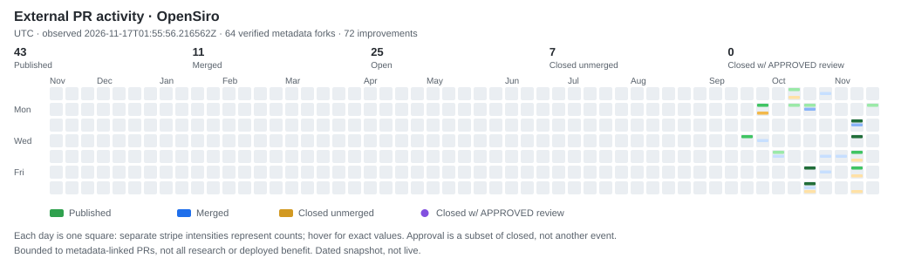

# OpenSiro external PR activity

Observed **2026-11-17T16:11:51.558653Z** (UTC). This is a **dated** first-party GitHub readback of PR URLs linked from verified fork-local metadata; not all historical research, not a live service or a benefit KPI.

| PR state / metric | Count |
| --- | ---: |
| Published (distinct linked original PR URLs) | **43** |
| Merged | **11** |
| Open | **25** |
| Closed without merge | **7** |
| Of closed-unmerged: an APPROVED review found | **0** |

Coverage: **64** source-verified forks, **74** improvement records, **43** distinct external PR URLs; the first-party PR readback was complete at observation time.

**Interpretation:** MERGED is GitHub's actual merged_at, while CLOSED_UNMERGED has no merge. Review APPROVED means an explicit GitHub review object (latest non-comment review per reviewer before close), **not** a merge, maintainer's verbal endorsement, or deployed value. The approved-closed value is **within**, not additional to, closed-unmerged. Replacement PR chains (e.g., Henterprise #1/#3) can create multiple published PRs but still belong to one improvement; all PR URLs are counted once.

**Reading one square:** three independent horizontal stripes: green = published, blue = merged, amber = closed without merge. Darker stripe means more events of **that type**, not a combined score. A purple dot marks a closed-unmerged PR whose latest eligible GitHub review was `APPROVED`; it is a subset of closed-unmerged, not an extra event. If none were approved in this snapshot, no purple dots appear. The per-day tooltip is embedded in the SVG; the breakdown table below remains readable when a Markdown renderer does not expose SVG tooltips.

Events use their original UTC publication, merge or closure dates, not metadata migration dates. Source owners remain original GitHub repositories; this file is a disposable derived snapshot. This derived view is refreshed from verified fork metadata and original GitHub PR facts; it is not a migration ledger or automatic external PR observer.

## Daily event counts (UTC)

| Date | Published | Merged | Closed unmerged | With APPROVED review |
| --- | ---: | ---: | ---: | ---: |
| 2026-09-23 | 2 | 0 | 0 | 0 |
| 2026-09-28 | 3 | 0 | 2 | 0 |
| 2026-09-30 | 0 | 1 | 0 | 0 |
| 2026-10-08 | 1 | 1 | 0 | 0 |
| 2026-10-11 | 1 | 0 | 1 | 0 |
| 2026-10-12 | 1 | 0 | 0 | 0 |
| 2026-10-19 | 1 | 2 | 0 | 0 |
| 2026-10-23 | 7 | 0 | 0 | 0 |
| 2026-10-24 | 8 | 1 | 1 | 0 |
| 2026-10-25 | 0 | 1 | 0 | 0 |
| 2026-10-29 | 0 | 1 | 0 | 0 |
| 2026-10-30 | 0 | 1 | 0 | 0 |
| 2026-11-05 | 0 | 1 | 0 | 0 |
| 2026-11-10 | 7 | 2 | 0 | 0 |
| 2026-11-11 | 7 | 0 | 0 | 0 |
| 2026-11-12 | 2 | 0 | 1 | 0 |
| 2026-11-13 | 2 | 0 | 1 | 0 |
| 2026-11-14 | 0 | 0 | 1 | 0 |
| 2026-11-16 | 1 | 0 | 0 | 0 |
