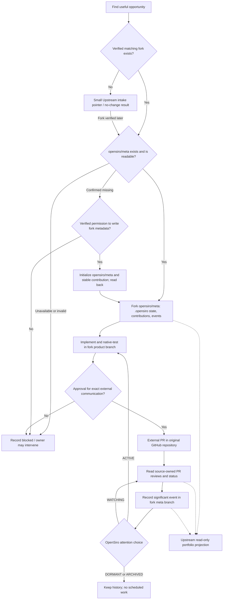

# Architecture — fork-local work, lean Upstream aggregate

[← Home](../README.md) · [Protocol](../PROTOCOL.md) · [Fork metadata](FORK_METADATA.md) · [Migration #2](https://github.com/opensiro/upstream/issues/2)

Upstream is **one operational S1 domain inside OpenSiro VSM OSS**, not a second copy of the VSM. Organization [ECOSYSTEM.md](https://github.com/opensiro/vsm-oss-organization/blob/main/docs/ECOSYSTEM.md) owns cross-repository boundaries. Profile owns VSM meanings; Skills owns assessment methodology; Index owns canonical assessments. Existing S2–S5 and global [TODO.md](https://github.com/opensiro/vsm-oss-organization/blob/main/TODO.md) remain in Organization.

## Human flow

On a full-cycle Upgrade, a verified existing fork with a **confirmed missing** `opensiro/meta` is not automatically rejected: under independent legal, provider and owner authorization it receives the minimal `.opensiro/` state and stable improvement record on a **new dedicated metadata branch**, then exact-SHA readback plus aggregate verification. An existing branch is reused, an unreadable/colliding branch fails closed, and a paused/stopped source is never automatically resumed. A chat-level batch does not make this write. [Detailed procedure](../PROTOCOL.md#upgrade-metadata-materialization--missing-opensirometa).

The owner can `PAUSE`, `STOP`, `RESUME` or change attention at the fork-local control point; a real executor must check control before new effectful actions. On 2026-11-19 the owner explicitly activated all 23 known [Upstream #58](https://github.com/opensiro/upstream/issues/58) issue-queue forks as `ACTIVE/ALLOW`, replacing the automatic PAUSE/DORMANT treatment for admitted owner-directed roadmap queue work. This is not a waiver of subsequent explicit owner STOP/PAUSE or publication consent. The GitHub change alone does not cancel an already running process. Attention is discretionary **with no mandatory maintenance TTL**.

## Who owns which fact?

| Fact | Real source of truth | Upstream role |
| --- | --- | --- |
| Harness identity and original product code/CI | Third-party original + verified matching `opensiro-contributions` fork | References only |
| Fork-local OpenSiro attention, work state and transaction/event history | **`.opensiro/` on verified fork's separate `opensiro/meta` branch** | Latest derived state, source SHA and links; no log duplication |
| Each independently scoped feature or repair | `.opensiro/contributions/<id>.json`, many per harness | Concise list and next action |
| Original, replacement or multiple external PRs | First-party external GitHub URLs | Live observed `OPEN/MERGED/CLOSED_UNMERGED/UNKNOWN` |
| Pre-fork research with no verified fork | Minimal Upstream intake issue | Source-backed blocker / decision, not fake code |
| Human attention intervention and event proof | Append-only fork-local `.opensiro/events/` | Visible projection with owner actor/next step |
| Organization current-work selection and S2–S5 | [VSM OSS Organization](https://github.com/opensiro/vsm-oss-organization) | No duplicate scheduler or VSM |
| Portfolio metrics | Existing Organization metrics contract | Read-only feed only when sources independently validated |

**A case is not a batch.** Several modifications and PRs can belong to one harness. Original/replacement PRs can refer to a single stable intervention. A har­ness may be dormant indefinitely while external PRs remain open.

## Why separate metadata branch?

Fork main and product feature branches preserve the source project's original README and CI and remain suitable for external upstream contributions. Committing `.opensiro/` on those branches risks exposing internal project machinery in foreign PR diffs. The dedicated `opensiro/meta` branch keeps metadata auditable and fork-local; independent event files allow conflict-safe revisions with a single-writer-per-fork checkpoint. Never force-push or merge this branch into external product work. A strict validator and exporter are future implementation under [migration #2](https://github.com/opensiro/upstream/issues/2); this document does not claim the metadata already exists in forks.

## Migration and observer boundary

Old immutable batches, cases, timestamps, publication ledgers, registry and watcher checkpoint remain in [upstream-old](https://github.com/opensiro/upstream-old). Parallel migration shards by **verified original target/fork**, not by batch; no fork must be created just to increase progress numbers. [Migration #2](https://github.com/opensiro/upstream/issues/2) defines discovery, verification, materialization, reconciliation, indexed progress, unknowns and conflicts.

A projected PR status is read back from the **original GitHub source**, not trusted because it appears in `.opensiro/`. Aggregates should publish observation time/source SHAs, no silently fabricated zero. The old site-sync and monitoring scripts are not automatically migrated.

The current Organization **`verified_external_outcomes`** accepted-merge KPI remains **unclaimed for new Upstream** while old producers remain in upstream-old. Merge observation or green CI is not verified user benefit, and the intended separate benefit semantics require their own future reviewed contract.
