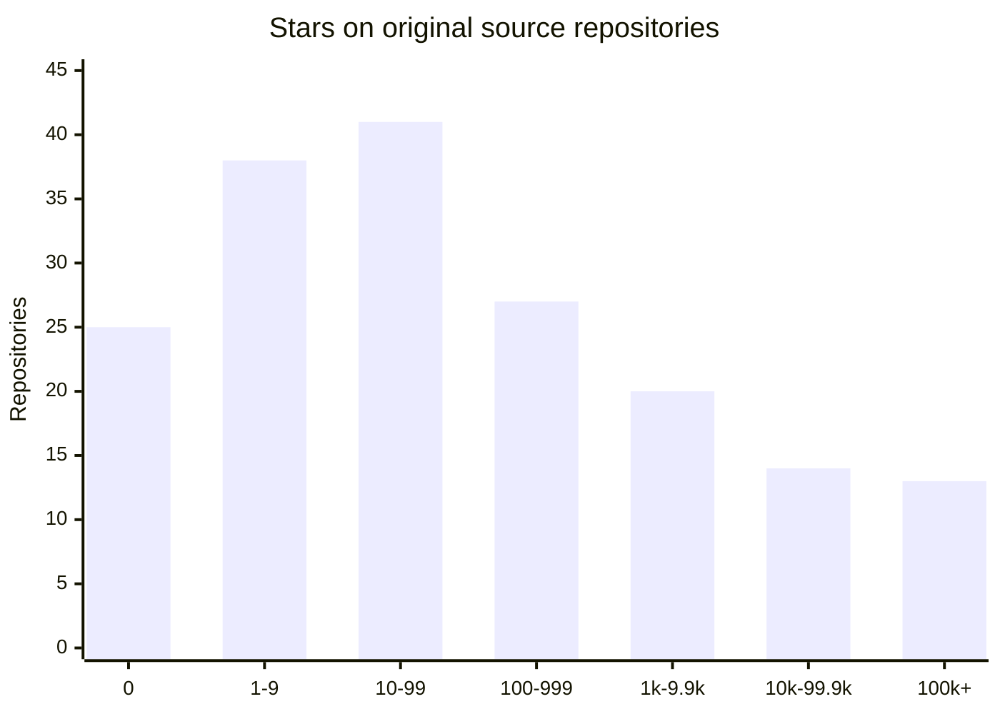

# Stars of source repositories behind OpenSiro Contributions forks — 2026-11-10 UTC

**Scope:** dated, read-only observation of public GitHub forks under [`opensiro-contributions`](https://github.com/opensiro-contributions). **Observed:** `2026-11-10T15:33:06.772Z` (the fork enumeration and per-repository reads span multiple requests). **Upstream local reference:** `main@1d1e0455a6bc7ecdfe60275019863010541dc55d`. This is not a live dashboard, canonical Index sample, product-quality score, contribution-effect measurement, or claim of third-party acceptance.

## Cohort and method

1. Enumerate public organization repositories with GitHub repository search (`org:opensiro-contributions fork:true`; two pages of 100 and 78).
2. Independently GET each exact `https://api.github.com/repos/opensiro-contributions/<fork-name>` and require `fork=true`, `parent` and `source` objects.
3. Use **`source.stargazers_count`**, not fork stars. The latter were `0` on all 178 observed working forks. All observed `parent.full_name` values matched `source.full_name`.
4. Join sources by case-insensitive `source.full_name` to the frozen [100-source priority snapshot](../data/fork-priorities/2026-11-08.json) and the generated [working-fork intent registry](../data/contribution-workspaces/registry.json). Do not infer exact identity from a matching destination basename.
5. Assign each repo to one non-overlapping decade-like bin (zero is separate). Counts can be reproduced from the accompanying [per-repository CSV snapshot](data/2026-11-10-fork-source-stars.csv). Stars are mutable GitHub metadata, not a historical property of a commit.

## Source-stars histogram (n=178)

| Stars of original source | All forks | Share | Priority snapshot (matched) | Additional forks |
| --- | ---: | ---: | ---: | ---: |
| 0 | 25 | 14.0% | 9 | 16 |
| 1–9 | 38 | 21.3% | 18 | 20 |
| 10–99 | 41 | 23.0% | 25 | 16 |
| 100–999 | 27 | 15.2% | 12 | 15 |
| 1k–9.9k | 20 | 11.2% | 11 | 9 |
| 10k–99.9k | 14 | 7.9% | 11 | 3 |
| 100k+ | 13 | 7.3% | 13 | 0 |
| **Total** | **178** | **100%** | **99** | **79** |

## Observations

- Median source stars: **34.5**; arithmetic mean: **17703.6**. The high mean reflects the long right tail, not the typical source.
- **104/178 (58.4%)** sources have fewer than 100 stars, including **25** with zero.
- The top **13** sources (100k+ stars each) account for **78.9%** of the total recorded stars. Summed stars are descriptive only: they do not imply distinct users or exposure.
- Matched sources from the deliberately reach-weighted [first-100 selection](../data/fork-priorities/2026-11-08.json): **99**, median **71**, with **24** at 10k+; other **79** forks: median **13**, with **3** at 10k+. All 13 sources at 100k+ belong to the priority group. This selection rule prevents generalizing the histogram to all harnesses.
- This is a portfolio of forked target repositories, not a set of all canonical Index INCLUDED assessments; do not interpret its popularity distribution as the Index distribution.

## Provenance and source-identity reconciliation

- [Generated registry](../data/contribution-workspaces/registry.json): **193** distinct intended source identities; **176** match the live fork `source.full_name`, **17** registry source identities do not match any observed live fork source, and **2** observed fork sources are outside that exact registry source set.
- The frozen priority group contains **100** source identities, of which **99** have exact live source matches. `NeoPanic/harness3` is not among those exact matches.
- Two basename-associated provenance differences need separate source-history review (possible upstream renames, not proven erroneous forks):
  - [opensiro-contributions/harness3](https://github.com/opensiro-contributions/harness3) currently reports source [NeoPanic/Ant3](https://github.com/NeoPanic/Ant3); the registry expects `NeoPanic/harness3` for the same proposed destination.
  - [opensiro-contributions/gyrfalcon](https://github.com/opensiro-contributions/gyrfalcon) currently reports source [cargopete/dino](https://github.com/cargopete/dino); the registry expects `cargopete/gyrfalcon` for the same proposed destination.
- Do **not** rewrite the frozen first-100 priority snapshot, change fork-lifecycle state, or attribute a rename solely from this star analysis.

## Highest-star sources in this observed cohort

| Original source | GitHub Stars |
| --- | ---: |
| [openclaw/openclaw](https://github.com/openclaw/openclaw) | 394,292 |
| [affaan-m/ECC](https://github.com/affaan-m/ECC) | 300,589 |
| [deepseek-ai/deepseek-harness](https://github.com/deepseek-ai/deepseek-harness) | 278,047 |
| [NousResearch/hermes-agent](https://github.com/NousResearch/hermes-agent) | 262,316 |
| [anomalyco/opencode](https://github.com/anomalyco/opencode) | 225,835 |
| [langflow-ai/langflow](https://github.com/langflow-ai/langflow) | 156,506 |
| [langchain-ai/langchain](https://github.com/langchain-ai/langchain) | 149,308 |
| [openai/codex](https://github.com/openai/codex) | 134,712 |
| [earendil-works/pi](https://github.com/earendil-works/pi) | 121,214 |
| [stablyai/orca](https://github.com/stablyai/orca) | 121,158 |

## Boundaries and follow-up

- Refresh the raw GitHub enumeration and all `source.stargazers_count` fields before citing an updated snapshot. The previous in-chat scan observed 177 forks; `NovaCode` was added during that work, and this independent scan returned 178.
- Reconcile the two identity differences through first-party source rename/history and registered source decisions in a separate task; no external repo mutation follows from this report.
- For prospective outcome analysis, relate popularity bands to **verified contribution outcomes** only through independently attributable PR/native evidence. Neither a fork nor a merged PR alone establishes benefit.
- **No external forks/PRs were changed; no new contribution publication, VSM classification, or operational metric claim.**
